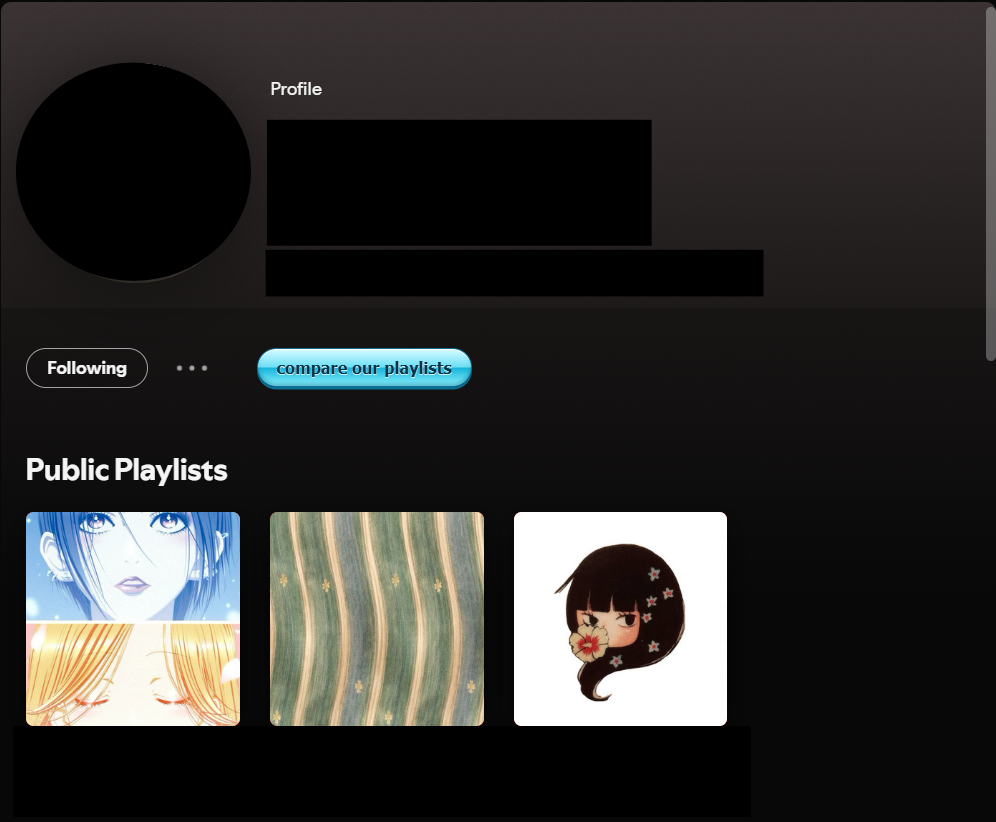
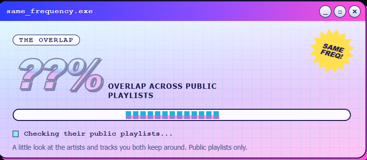
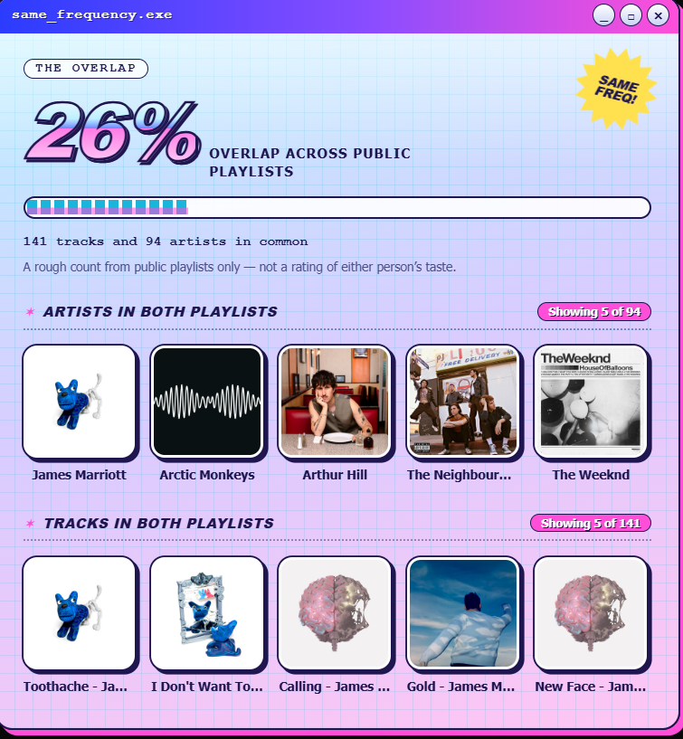

<div align="center">

# Same Frequency

**[LOGO PLACEHOLDER — put the logo here]**

**How much music do you and a friend have in common?**

Compare the artists and tracks in your public Spotify playlists with a friend's.

<br>

🎧 &nbsp; Public playlists only &nbsp; · &nbsp; 🔒 &nbsp; No listening history &nbsp; · &nbsp; 💚 &nbsp; Just for fun

</div>

---

## At a glance

|                       |                                                         |
| --------------------- | ------------------------------------------------------- |
| **What it is**        | A small add-on for the Spotify desktop app              |
| **What it does** | Compares public playlists and shows an overlap score |
| **What you need**     | Spotify desktop and [Spicetify](https://spicetify.app/) |
| **What it can't see** | Private playlists or anyone's listening history         |

> **New to Spicetify?** Start with the [Spicetify installation guide](https://spicetify.app/docs/installation/). This extension needs Spicetify; it doesn't run in Spotify's web player or mobile app.

## Preview

### Profile button

The comparison button appears on a friend's profile, above their public playlists.



### Playlist comparison in progress

The extension checks the public playlists it can read and shows a loading status.



### Comparison results

See the overlap score and examples of artists and tracks found in both playlists.



## Use it

1. Open Spotify desktop and go to **a friend's profile**.
2. Click **compare our playlists**.
3. Let it check the public playlists it can read.
4. Check the score, shared tracks, and image cards for artists and tracks you both have in playlists. Track cards use album artwork; artist cards use artist photos when available, with related album artwork as a fallback. The comparison opens in a larger window to fit the cards.

The button appears on other people's profiles, not your own. Both profiles need at least one public playlist with tracks.

## What does the score mean?

The score is a rough measure of playlist overlap—not a rating of either person's taste. It combines:

- Shared tracks, compared with the number of tracks in the smaller set.
- Shared artists, compared with the number of artists in the smaller set.

For example, **100% doesn't mean your whole music taste is identical**. It means everything found in the smaller set also appeared in the larger set.

The extension checks up to **25 public playlists per person**, with up to **500 tracks per playlist**. Private playlists and listening history are not accessed.

## Install

### Option 1: Spicetify Marketplace

If Marketplace is already set up:

1. Open **Marketplace** in Spotify.
2. Find **Same Frequency** in the **Extensions** section.
3. Install it and reload Spotify if prompted.

### Option 2: Install the file yourself

1. Make sure Spotify desktop and Spicetify are installed.
2. Open a terminal (PowerShell on Windows) and run:

   ```text
   spicetify config-dir
   ```

   This prints your Spicetify configuration folder. Inside it, open or create a folder named `Extensions`.

3. Copy `same-frequency.js` into the `Extensions` folder.
4. In the terminal, run these commands one at a time:

   ```text
   spicetify config extensions same-frequency.js
   spicetify apply
   ```

5. Restart Spotify. Open a friend's profile and look for **compare our playlists**.

## Having trouble?

| What you see              | What to try                                                                                                     |
| ------------------------- | --------------------------------------------------------------------------------------------------------------- |
| No public playlists found | Make one of your playlists public. Your friend will need a public playlist too.                                 |
| No tracks found           | Check that a public playlist actually has songs in it.                                                          |
| Your own profile is open  | Go to someone else's profile; the button only works there.                                                      |
| Still not working         | Restart Spotify and try again. Spotify updates can sometimes change how extensions access playlist information. |

---

<div align="center">

Made for comparing playlists with friends. The score is just for fun.

</div>
