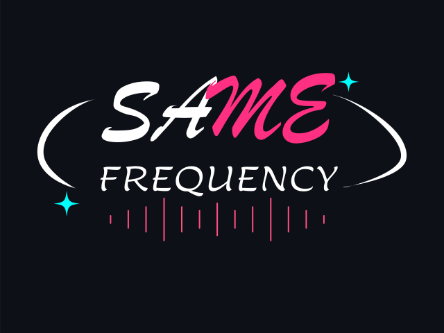

<div align="center">



### How in sync are your playlists?

Compare your public Spotify playlists and find the artists and songs you both keep coming back to.

**🎧 Public playlists only &nbsp; · &nbsp; 🔒 No listening history &nbsp; · &nbsp; 💚 Just for fun**

</div>

## Catch the vibe

| Find the button | Let it do its thing | Meet your music twins |
|:---:|:---:|:---:|
|  |  |  |
| Visit a friend's profile. | Same Frequency checks your public playlists. | See your overlap, plus shared artists and songs. |

## How to play

1. Open a friend's profile in the **Spotify desktop app**.
2. Click **compare our playlists**.
3. Take a peek at your shared artists, songs, and overlap score.

The score is a fun little snapshot, not a rating of your taste. **100%** means everything found in the smaller playlist collection also appears in the larger one—not that you have identical taste in everything.

> **A tiny privacy promise:** Same Frequency checks public playlists only. No private playlists, no listening history. Both people need at least one public playlist with songs.

## Get in on it

Same Frequency needs [Spicetify](https://spicetify.app/) and the **Spotify desktop app**. It doesn't work in Spotify mobile or the web player.

**Marketplace:** Open Marketplace in Spotify, find **Same Frequency** under **Extensions**, and install it.

**Manual install:**

1. [Install Spicetify](https://spicetify.app/docs/installation/) if you haven't already.
2. Run `spicetify config-dir` to find your Spicetify folder. Put `same-frequency.js` in its `Extensions` folder.
3. Run these commands, one at a time:

   ```text
   spicetify config extensions same-frequency.js
   spicetify apply
   ```

4. Restart Spotify and head to a friend's profile.

The button shows up on **other people's profiles**, not your own. No button? Make sure both profiles have public playlists, then give Spotify a restart.

Same Frequency checks up to **25 public playlists** and **500 songs per playlist** for each person. Now go find your musical doppelgänger. ✨
